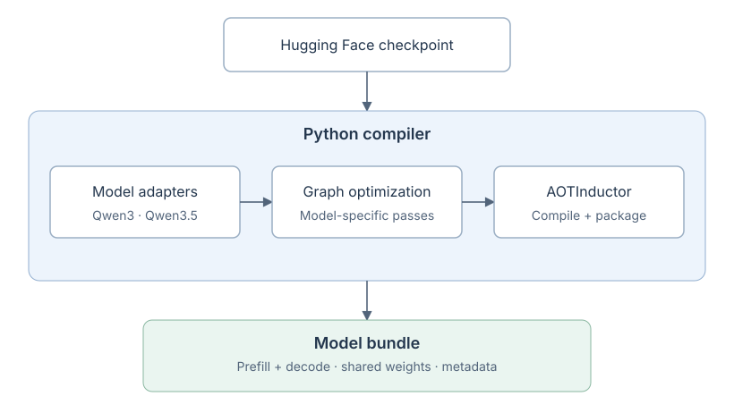
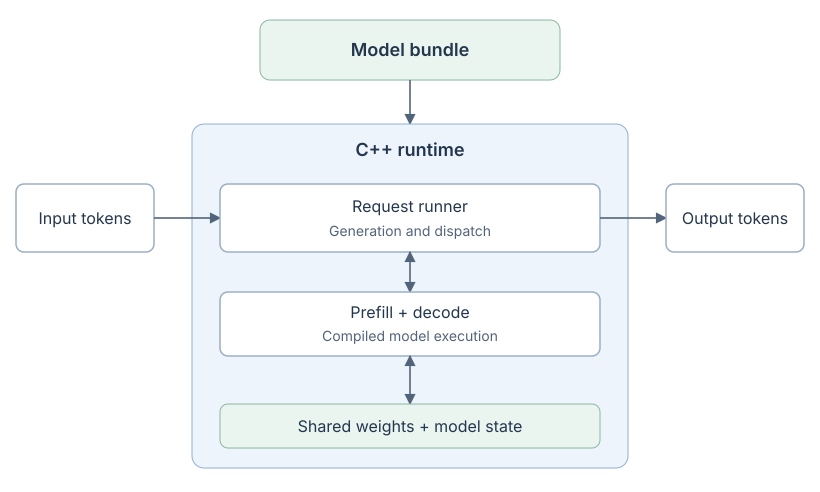

# xinfer

Compile Hugging Face Qwen models with PyTorch AOTInductor and run them in C++
without Python. xinfer provides batch-one BF16 inference, paired prefill/decode
packages, shared weights and explicit model state.

The model pipelines cover [Qwen3-0.6B](compiler/qwen3/README.md) and
[Qwen3.5-0.8B / 4B](compiler/qwen35/README.md) (text only). Device-specific
setup and validation status are documented for [L20 and GB10](environments/README.md).
Numerical acceptance depends on the model, package and workload; see
[validation and limitations](#validation-and-limitations).

## Compiler architecture

Python prepares the checkpoint, adapts the model to an explicit tensor/state
interface, and exports both entry points in one invocation. Model-specific graph
passes run before AOTInductor compilation. Shared helpers collect tensor constants,
package native dependencies and write versioned metadata.



Both families use FlashAttention over the populated KV prefix. Qwen3.5 also uses
Triton DeltaNet kernels and graph passes for linear packing and supported decode
projections. Build `xinfer_attention_ops` before export; its library is embedded
in both `.pt2` files and loaded by the standard AOTI loaders. See the
[attention guide](docs/flash-attention.md) for the operator and packaging contract.

The deployment bundle contains **five files**: `prefill.pt2`, `decode.pt2`,
`weights.pt`, `prefill.json` and `decode.json`. Graph dumps and build logs are
export diagnostics. Deploy the complete bundle with matching LibTorch/CUDA;
see [package metadata](docs/package-metadata.md) and
[runtime installation](environments/README.md#install-and-relocate-the-runtime).

## Runtime architecture

The same native executables serve both model families. Metadata selects the
model-specific ABI checks; `runtime/common/` owns loading, state, request
validation, prompt chunking and prefill/decode dispatch.



Both loaders borrow the same weight storage through `user_managed` loading.
KV buffers update in place; Qwen3.5 convolution and recurrent outputs replace
previous state. The weight pool outlives both loaders.

| Executable | Purpose |
| --- | --- |
| `xinfer_aoti` | Greedy generation from token IDs, stopping at EOS or the output budget. |
| `xinfer_benchmark` | Fixed-token prefill/decode timing and memory measurements. |
| `xinfer_validate` | Logit/state traces and runtime correctness checks. |

Python handles checkpoint preparation and offline tokenization/text decoding.
Native execution requires LibTorch/CUDA but loads neither Python nor
`libtorch_python`.

## Getting started

1. Follow the [environment guide](environments/README.md) to create a fresh
   model venv and build compiler kernels and native executables in `build/<model>/`.
   Dependency pins live in `environments/<target>/<model>_requirements.txt`.
2. Follow the [Qwen3](compiler/qwen3/README.md) or
   [Qwen3.5](compiler/qwen35/README.md) guide to prepare a checkpoint, export a
   bundle, encode a prompt and run native generation. Use fresh output paths.
3. Run [numerical and runtime validation](docs/development-tools.md#python-validation-tools)
   for each new bundle, then measure it with the
   [benchmark tools](docs/development-tools.md#benchmark-hf-and-native-aoti).

Run Python commands as modules from the repository root, using the environment
for that model. For example, after setting up Qwen3 on L20:

```bash
PY=work/l20/qwen3-torch213-venv/bin/python
"$PY" -m tools.prepare --help
"$PY" -m compiler.qwen3.export --help
"$PY" -m tools.validation.validate --help
"$PY" -m tools.benchmark --help
```

Export chooses allocated context capacity with `--max-context-length`; omitting
it uses the model config's declared ceiling. Compiled prefill accepts **2–512
tokens per call**. Generation chunks longer prompts automatically and uses decode
for a one-token remainder. The complete prompt plus requested output budget must
fit the bundle's capacity. Increasing capacity requires re-exporting the model.

## Validation and limitations

Accuracy validation follows **HF → adapted/optimized eager → Python AOTI →
C++ AOTI**, using identical teacher-forced inputs. The eager stage includes the
adapters and graph transformations used by the compiled model. Native/Python
AOTI parity must be bitwise; HF logit comparisons use the
[shared numerical policy](docs/development-tools.md#shared-numerical-policy).
State ownership, masking, reset/reuse and boundary checks remain required.

Benchmarks are separate from accuracy validation. `tools.benchmark` supports
`run`, paired-package `compare` and `check-idle` for both families. The eager
baseline is unchanged HF with a dynamic cache. HF receives the whole prompt in
one call, while native execution uses chunks; reports record that difference.
Use idle-GPU checks and repeated measurements for performance conclusions.

- **Numerics:** Qwen3.5 HF acceptance remains open. Recorded model-default
  Qwen3 and Qwen3.5 runs also retain HF numerical failures despite native/Python
  bitwise parity. Consult the [validation records](docs/experiments/common-runtime.md)
  and model guides for the exact profiles tested.
- **Devices and context:** recorded 16K-context L20 runs cover Qwen3-0.6B and
  Qwen3.5-0.8B/4B; those expanded profiles have not been validated on GB10.
- **CPU portability:** compiled wrappers can inherit the build host's instruction
  set. CPU compatibility is not checked; use a compatible CPU or re-export on
  the destination host.
- **Scope:** batch-one text generation; no native tokenizer, serving API or
  concurrent request scheduler. CUDA Graph integration is deferred.

## Code and documentation map

| Location | Responsibility |
| --- | --- |
| [`compiler/`](compiler/) | Model loading, adapters, graph passes, kernels and paired export; common metadata, weight and packaging helpers. |
| [`runtime/`](runtime/) | Shared C++ runner and executables; model-specific ABI checks. |
| [`tools/`](tools/) | Checkpoint preparation, numerical validation, benchmarks and focused diagnostics. |
| [`environments/`](environments/README.md) | Per-device/model dependency pins, setup, checks, builds and deployment. |
| [`plugins/xinfer-perf/`](plugins/xinfer-perf/README.md) | Fusion and kernel optimization workflows for GB10 in Codex and Claude Code. |
| [`docs/`](docs/) | [Development and tests](docs/development-tools.md), [metadata/ABI](docs/package-metadata.md), [attention](docs/flash-attention.md) and [experiment history](docs/experiments/). |

Tests follow the code they cover. Generated builds go in `build/<model>/`,
packages/results in `artifacts/`, and venvs/scratch files in `work/`; these paths
are ignored. See [AGENTS.md](AGENTS.md) for contribution rules and
[PLAN.md](PLAN.md) for planned work.
