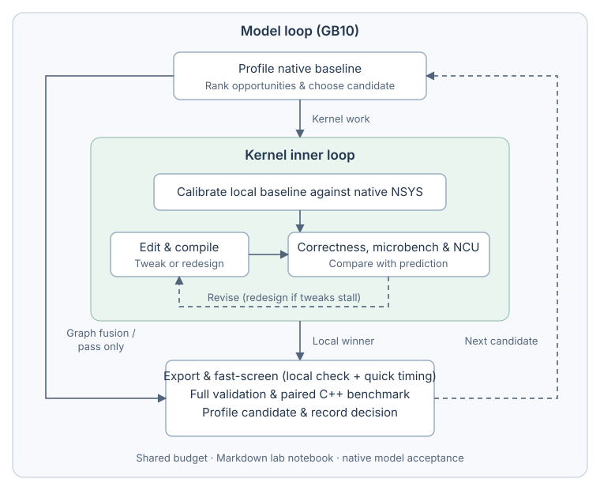

# xinfer-perf

A shared `optimize` skill for fusion and GPU kernel optimization in xinfer on
**NVIDIA GB10 (SM 12.1)**. It defaults to native decode latency per token and
invokes existing xinfer tools, `nsys`, and `ncu` directly.

## Workflow

The [optimize skill](skills/optimize/SKILL.md) runs a profile-first model loop
with an optional nested kernel inner loop for custom or rewritten kernels:



All runs are tracked in a single Markdown
[lab notebook](skills/optimize/references/lab-notebook.md) under ignored
`work/perf/<run>/log.md`, linking directly to existing benchmark, validation,
and profiler artifacts.

## Contents

- [skills/optimize/SKILL.md](skills/optimize/SKILL.md) — End-to-end optimization loop, budget, and acceptance rules.
- [references/profiling.md](skills/optimize/references/profiling.md) — `nsys`/`ncu` capture commands, phase separation, `.pt2` inspection, and local baseline calibration.
- [references/kernel-loop.md](skills/optimize/references/kernel-loop.md) — Kernel inner loop (calibration, iteration, redesign rule) and xinfer Triton / C-shim integration paths.
- [references/hardware.md](skills/optimize/references/hardware.md) — GB10 (SM 12.1) target profile, decode bottlenecks, and hardware/toolchain gotchas.
- [references/lab-notebook.md](skills/optimize/references/lab-notebook.md) — Append-only Markdown template for recording hypotheses, revisions, measurements, and decisions.

## Load the plugin

Run these commands from an xinfer checkout.

**Claude Code** (load for one session):

```bash
claude --plugin-dir "$PWD/plugins/xinfer-perf"
```

Invoke `/xinfer-perf:optimize`, or describe a GB10 fusion or kernel optimization task.

**Codex** (register the local marketplace in `.agents/plugins/marketplace.json` once, then add):

```bash
codex plugin marketplace add "$PWD"
codex plugin list --marketplace xinfer-local --available --json
codex plugin add xinfer-perf@xinfer-local
```

Start a new Codex session in the checkout and select the `optimize` skill.
Refresh the local install after editing plugin files, since installed plugins
may run from a cached copy.

The plugin contains only instructions; the **xinfer checkout and GB10 host** are
separate inputs. Always run project commands in the target checkout with its
matching GB10 environment, and never place checkpoints, builds, or experiment
logs inside the plugin directory.

## Example requests

> Use xinfer-perf to investigate GB10 decode latency for this compiled model.
> Profile the baseline first, then try at most three fusion or kernel candidates
> supported by that profile within two hours. Keep numerical failures visible.

> Continue the investigation in `work/perf/qwen35-decode/log.md`. Read the
> recorded results and finish the pending comparison before trying another change.

Runtime and generation-loop optimizations (e.g., CUDA Graphs) are outside this
skill. This version supports Codex and Claude Code.

## Validate manifests

```bash
claude plugin validate plugins/xinfer-perf
codex plugin list --marketplace xinfer-local --available --json
```

Packaging references:
[Codex](https://developers.openai.com/plugins/build/plugins) and
[Claude Code](https://code.claude.com/docs/en/plugins-reference).
